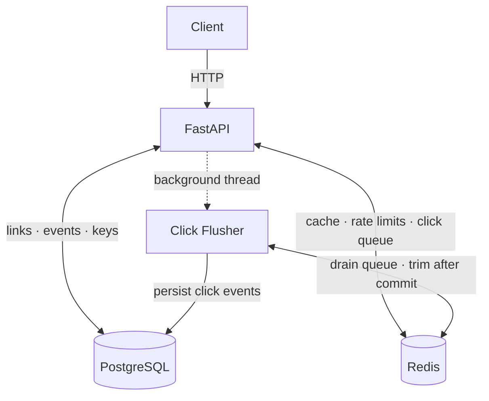

# Snip


A URL shortener with click tracking. 

FastAPI + Postgres + Redis, fully containerized with Docker Compose.

- Paste in a long URL, get back a short code. 
- Visiting the code redirects to the target and records a click. 
- Per-link click counts and recent click times are available on demand.

-----

## Stack

| Component | Role |
|-----------|------|
| FastAPI | HTTP API |
| Postgres | Source of truth: links, click events, API keys |
| Redis | Code → URL cache · click queue · rate-limit counters |
| Docker Compose | Orchestrates four services: `api`, `db`, `cache`, `migrate` |


### Architecture



-----

## Prerequisites

- **Docker Engine** 20.10+ : Install guide https://docs.docker.com/get-docker/

- **Docker Compose v2** : the `docker compose` plugin, **not** the legacy `docker-compose` binary.
  Verify with `docker compose version`.

- **make** :  every command below uses it. `sudo apt install make` (Debian/Ubuntu).

- **Port 8000 free** on the host.

Everything else is containerized.

Works on Linux, macOS, and Windows via WSL2.

Developed and tested on `linux/arm64` (WSL2 Ubuntu 24.04). 
No architecture-specific code paths.

----

## Quickstart

```bash
git clone https://github.com/sticksnstonesHURT/snip.git
cd snip

cp .env.example .env      # defaults work as-is for local use
make up
```


The first make up takes 60–90 seconds — it pulls base images and installs dependencies.

Later runs are a few seconds.

You should see:
```
 Container snip-cache-1   Healthy
 Container snip-db-1      Healthy
 Container snip-migrate-1 Exited    ← correct, see note below
 Container snip-api-1     Started
```

> **`snip-migrate-1` Exited is success, not a crash. `migrate` is a one-shot job: it applies 
> Alembic migrations, exits 0, and the API starts. Migrations run automatically on first start; 
> there is no manual migration step for a fresh install.


Verify:

```bash
make health        # {"status":"ok"}
```
<br>

**API: http://localhost:8000**

**Interactive docs (Swagger UI): http://localhost:8000/docs**

<br>

### First request

**Writes (Creating a Shortened URL) require an API key.**

Mint one, then create a link:

```bash
make key n="laptop"              # prints the key ONCE — save it

export SNIP_API_KEY='snip_...'   # paste the key


curl -X POST localhost:8000/links \
  -H 'Content-Type: application/json' \
  -H "X-API-Key: $SNIP_API_KEY" \
  -d '{"url":"https://example.com/some/long/path"}'
# {"code":"aB3xK9z","target_url":"https://example.com/some/long/path","clicks":0,"created_at":"..."}


curl -i localhost:8000/aB3xK9z
# HTTP/1.1 307 Temporary Redirect
# location: https://example.com/some/long/path
```

**The key cannot be recovered; only its sha256 hash is stored.**
A new key must be generated if lost.


### Configuration

`.env` (copy from `.env.example`):

| Variable | Default | Purpose |
|---|---|---|
| `POSTGRES_USER` / `POSTGRES_PASSWORD` / `POSTGRES_DB` | `snip` / — / `snip` | Postgres credentials; also assembled into `DATABASE_URL` |
| `CODE_LENGTH` | `7` | Length of generated short codes |
| `FLUSH_INTERVAL_SECONDS` | `5` | How often queued clicks are flushed to Postgres |
| `RATE_LIMIT_PER_MINUTE` | `60` | Per-key request limit |

<br>

**Note: `DATABASE_URL` and `REDIS_URL` are constructed in `docker-compose.yml`, not set in `.env`.**


-----------

## Endpoints

| Method | Path | Auth | Description |
|---|---|---|---|
| `POST` | `/links` | ✅ | Create a short link |
| `GET` | `/links` | – | List all links, newest first |
| `GET` | `/links/{code}/stats` | – | Click count + recent click times |
| `DELETE` | `/links/{code}` | ✅ | Delete a link and its click events |
| `GET` | `/{code}` | – | Redirect (`307`) to the target URL |
| `GET` | `/health` | – | Liveness check |

<br>
Writes require auth. Reads and redirects are open.


### Error codes: 
- `401` missing/invalid key
- `404` unknown code 
- `405` wrong method
- `422` invalid body (URL validation) 
- `429` rate limit exceeded.


----------


## Authentication

`POST /links` and `DELETE /links/{code}` require an `X-API-Key` header.

Keys are `snip_` + 32 random bytes (`secrets.token_urlsafe(32)`). 
**Only the sha256 hash is stored**: the raw key is printed once at creation and cannot be recovered.

```bash
make key n="laptop"
```

Key creation runs a one-off container invoking `python -m app.createkey`. 

There is deliberately **no HTTP endpoint** for minting keys: it would have to be either unauthenticated (anyone can mint keys) or authenticated (need a key to get a key). 

Requiring shell access to the host is the correct trust boundary.

Why plain sha256 and not bcrypt: password hashing exists to make *guessing* expensive against low-entropy inputs. 

A 256-bit random string isn't guessable at any speed, so a fast one-way hash is the right tool.


-------

## Rate limiting

60 requests/minute **per key**, fixed-window, counted in Redis at `ratelimit:<key-hash>:<window>`.

Over the limit returns `429`.

**Fixed-window means the counter resets on a wall-clock minute boundary; see [Known limitations](#known-limitations).**

------

## Click tracking

Redirects never write to Postgres.

`GET /{code}` resolves the target URL (Redis first, Postgres on a cache miss), then records the
click **entirely in Redis**:

- `INCR clicks:pending:{code}`
- `RPUSH clicks:queue {event_id, code, clicked_at}`

A background flusher drains the queue into Postgres: every `FLUSH_INTERVAL_SECONDS`, and once more during shutdown (from the app's lifespan hook, so `docker compose stop` delivers pending clicks).

<br>

The flush is crash-safe by construction:

1. **Peek, then trim but never pop.** `LRANGE` the first batch, write it, commit, *then* `LTRIM`.
   A crash at any point leaves the entries on the queue for the next flush.
   
2. **Idempotent inserts.** `INSERT ... ON CONFLICT (event_id) DO NOTHING RETURNING link_id`.
   
   A re-delivered batch inserts nothing and returns nothing, so counters don't double-count.

<br>

Together that's **at-least-once delivery + idempotent writes**. `click_events.event_id` (unique) is what makes it safe. 
Without it, a mid-flush crash would double-count.

<br>

### Consequences:

- `links.clicks` **lags** by up to `FLUSH_INTERVAL_SECONDS`.

- `GET /links/{code}/stats` returns `pending_clicks` alongside `clicks`, so the lag is visible:
  `clicks + pending_clicks` is the true total.

- Redis is **persisted** (`--appendonly yes`, `redisdata` volume), because it holds data that isn't in Postgres yet.

---------

## Migrations

Schema is owned by Alembic. 

Revisions live in `alembic/versions/` and are applied by the `migrate` service before the API starts:

```
db healthy  ->  migrate (alembic upgrade head) exits 0  ->  api starts
```

<br>

**If a migration fails, the API does not start. That is deliberate: a failed deploy beats a running app against a half-migrated schema.**

```bash
make build                              # rebuild (picks up alembic/versions/)
make up                                 # migrate runs, then api
docker compose logs migrate             # what was applied

# after editing app/models.py, generate a revision:
make migration m="add thing to links"

# inspect / roll back
make migrate                            # apply pending revisions
make check                              # detect drift between models and DB
docker compose run --rm api alembic current
docker compose run --rm api alembic history
docker compose run --rm api alembic downgrade -1
```

`make migration` bind-mounts the project directory because the API runs with `read_only: true` and cannot write a revision file to the repository. 

Commands that only touch Postgres (`upgrade`, `current`, `check`) need no mount.

<br>

Two gotchas:

- Services that build the same Dockerfile must declare the same `image:` name (see `api` and
  `migrate`), or they build separate images and drift — the migration then silently no-ops.

- `alembic downgrade -1` means "one revision back from wherever the database *actually* is". Check `alembic current` first; downgrading past the baseline drops tables.

------------------

## Container hardening

| Control | api | db | cache | Why |
|---|---|---|---|---|
| Non-root user | ✅ `appuser` | ✅ `postgres` | ✅ `redis` | Removes the value of an escape |
| `no-new-privileges` | ✅ | ✅ | ✅ | setuid binaries can't elevate |
| `cap_drop: ALL` | ✅ | ❌ | ❌ | Only `api` needs no capabilities at all |
| `read_only` rootfs | ✅ + tmpfs `/tmp` | ❌ | ❌ | `api` never writes to disk; databases must |
| `init: true` | ✅ | – | – | `tini` as PID 1 forwards signals, reaps zombies |
| Memory / CPU limits | 256M / 1.0 | 256M / 1.0 | 256M / 1.0 | A container can't consume host RAM unbounded |
| Log rotation | 10m × 3 | 10m × 3 | 10m × 3 | Caps log growth at ~30MB per container |


<br>

`migrate` runs the same image as `api` with the same hardening (non-root, `cap_drop: ALL`,
`read_only`, `no-new-privileges`), at 0.5 CPU since it's a one-shot job.


<br>

### Why `db` and `cache` aren't `cap_drop: ALL`

The official Postgres and Redis images start as root, `chown` their data directories, then drop to
their service user — requiring `CAP_CHOWN`, `CAP_FOWNER`, `CAP_SETUID`, `CAP_SETGID`. 

Dropping all capabilities makes them exit at startup (`exited 127`).

They reach the same end state anyway — non-root, no effective capabilities — because their
entrypoints do it themselves:


| | CapBnd (ceiling) | CapEff (running) | User |
|---|---|---|---|
| api | `0x0` | `0x0` | appuser |
| db | `0xa80425fb` | `0x0` | postgres |


<br>

### Verifying

```bash
docker inspect snip-api-1 --format 'readonly={{.HostConfig.ReadonlyRootfs}} init={{.HostConfig.Init}} caps={{.HostConfig.CapDrop}}'

# writes must fail — EROFS on a read-only mount, EACCES where mode bits deny first
docker compose exec api sh -c 'touch /home/appuser/x'   # Read-only file system
docker compose exec api sh -c 'touch /tmp/x'            # ok (tmpfs)

# capabilities from the kernel, not from Docker
docker compose exec api cat /proc/1/status | grep -E '^Cap'
```

-----


## Design notes

- **Cache-aside** for the code → URL lookup: the redirect reads Redis first, falls back to Postgres on a miss, then warms the cache (`link:{code}`, 1 hour TTL).

- **Cache invalidation**: deleting a link deletes its Redis key, so a deleted code can't keep
  resolving. 
  Without that it would serve from cache for up to an hour.

- **Reads are open, writes are authenticated.** Short links exist to be shared; requiring a key to follow one defeats the purpose.

- **Auth runs before rate limiting**, because you can't limit by key before knowing the key is
  valid. 
  Consequence: an invalid key costs one indexed DB lookup before returning `401`.

- **Migrations gate startup.** `api` waits on `migrate` exiting 0, so a broken schema produces a failed deploy rather than a running app that fails on first request.

- **`read_only` works because of `PYTHONDONTWRITEBYTECODE=1`** in the Dockerfile. 
	Without it Python would try to write `.pyc` files on import and crash.

- **Environment variables take two hops.** 
	`.env` → Compose interpolation → the service's environment: → Python: A variable in `.env` that no service lists **never reaches the container**.

- **The container user is uid 1000**, matching a typical host user, which is what makes host bind-mounts (e.g. `make migration`) writable without permission juggling.

------

## Known limitations

- **Fixed-window rate limiting** allows up to ~2× the limit across a window boundary: 60 requests at the end of one window and 60 at the start of the next are all legal. 

- **Invalid keys cost a DB lookup before returning `401`**:  no IP-based limiting precedes auth.

- **The click flusher assumes a single `api` instance.** 
	Two replicas would peek the same queue window; idempotency protects the counts, but not the pending counter. 
	Real fix: Redis Streams with consumer groups, or `LMOVE` to a per-worker list.


- **`links.clicks` lags by up to `FLUSH_INTERVAL_SECONDS`.** `/stats` exposes `pending_clicks` so the lag is visible rather than silent.

- **No key rotation or revocation.** Keys are created by CLI; revoking one means deleting its row manually.

- **`logging.basicConfig` is applied in `app/main.py`**: effective, but blunt. Explicit uvicorn log configuration would be tidier.


-------


## Commands

| Target | What it does |
|---|---|
| `make up` | Start all services (builds first if needed). Runs migrations. |
| `make down` | Stop and remove containers. **Volumes are kept.** |
| `make nuke` | `down` plus delete volumes. **Destroys all data.** |
| `make ps` | Container status |
| `make logs` | Follow api logs (`docker compose logs -f api`) |
| `make shell` | bash inside the api container |
| `make db-shell` | psql session on Postgres |
| `make cache-shell` | redis-cli session on Redis |
| `make health` | Hit `/health` |
| `make smoke` | End-to-end: create + list a link. Prompts for your API key without displaying it. |
| `make key` | Mint an API key (one-off container) |
| `make build` | Build images |
| `make rebuild` | Build with `--no-cache` |
| `make migrate` | Apply pending migrations |
| `make migration` | Generate a revision — `make migration m="message"` |
| `make check` | Detect drift between models and DB |

`make help` prints the same list.


**Note: `make smoke` requires a valid API key. Generate one using `make key n="xyz"` if you don't already have one. Enter the key when prompted.**


-----------

## Troubleshooting

| Symptom | Cause | Fix |
|---|---|---|
| `make up` fails: `dependency failed to start: container snip-migrate-1 exited (1)` | A migration errored, so the API never started | `docker compose logs migrate`: the traceback is there, not in the api logs |
| `snip-migrate-1` shows `Exited (0)` and you think it crashed | It's a one-shot job, not a service | Nothing to fix. `docker compose ps -a` lists it as Exited (0). |
| `bind: address already in use` / port 8000 | Something else owns 8000 | `sudo lsof -i :8000`, or change the mapping in `docker-compose.yml` (`"XXXX:8000"`) and use `localhost:XXXX` |
| `make up` failed on port 8000, and now `make health` prints nothing / `make ps` shows no ports | The failed start left the container with no network endpoint. Starting an existing container doesn't re-establish a binding that failed to set up | `make down && make up`, or `docker compose up -d --force-recreate api` |
| `no matching manifest for linux/arm64` | Image has no ARM build | It names the image. Try `docker compose build --platform linux/amd64`, or find an ARM-capable base |
| Build appears hung on the first run | Pulling the base image (~90s), and the tag moved so the layer cache missed | Wait. Subsequent builds are cached. **Pin the digest in `Dockerfile` for reproducibility** |
| `401 {"detail":"missing X-API-Key header"}` | **Writes need auth** | Add `-H "X-API-Key: $SNIP_API_KEY"` |
| `429 rate limit exceeded` | Over 60 requests/min for that key | Wait for the window to roll, or raise `RATE_LIMIT_PER_MINUTE` in `.env` and `make up` |
| `500` on `GET /links` after editing a model | Model and database disagree | `make check`; it reports the drift. Then `make migration m="..."` and `make build && make up` |
| `make migration` fails: `Read-only file system` | Missing the bind mount | Use `make migration`, which mounts `$PWD`. A bare `docker compose run --rm api alembic revision` will fail |
| Env var in `.env` has no effect in Python | `.env` feeds Compose interpolation, not the container | Add it to the service's `environment:` block in `docker-compose.yml` |

<br>

### Get logs: 
- `make logs` (**follows api logs only**) 
-  For migration logs, run `docker compose logs migrate`.
-  For PostgreSQL logs, run `docker compose logs db`
-  For redis/cache logs, run `docker compose logs cache`.


*Note: The `make logs` target does not accept a service name as an argument.*


-----


## Cleanup

```bash
make down       # stop containers. Volumes and data are KEPT.
make nuke       # stop AND delete volumes — destroys all data
```

- `down` keeps everything. Links, click events, API keys, and the Redis queue all survive in the `snip_pgdata` and `snip_redisdata` named volumes. `make up` brings it all back exactly as it was.
- `nuke` is destructive and irreversible. It removes both volumes, permanently deleting links, click events, stored API-key hashes, and any other persisted database or Redis data. Any existing API keys will no longer authenticate.


To also remove the built images:
```bash
docker compose down --rmi local
```

To reclaim everything Docker holds for this project:
```bash
make nuke
docker compose down --rmi local --remove-orphans
```


-------

## Build history

- **Phase 1: Containerize.** Multi-stage build, Compose networking, volumes, cache-aside. See `docs/`.

- **Phase 2: Harden.** Non-root, capabilities, read-only rootfs, resource limits, log rotation. See `docs_phase_2/`.

- **Phase 3: Scale the design.** Alembic migrations, Redis click batching, API key auth + rate limiting. See `docs_phase_3/`.
