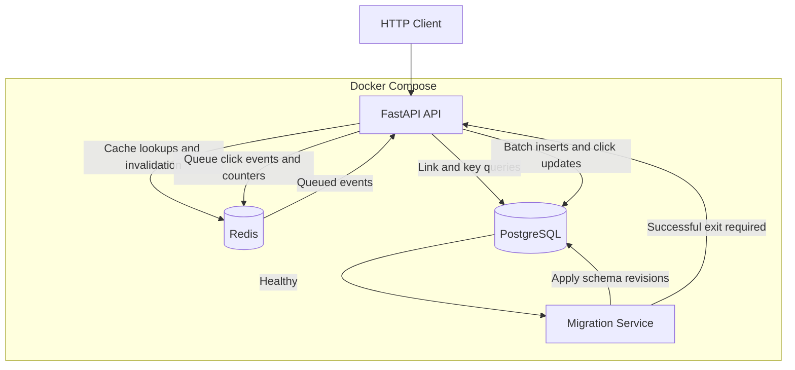

# Phase 3: Overview and Architecture

## 1. Purpose

Phase 3 evolves Snip from a containerized URL shortener into a more robust application with controlled database schema changes, asynchronous click recording, and protected write operations.

- Phase 1 established the application and its Docker Compose environment. 
- Phase 2 hardened the containers. 
- Phase 3 builds on both by changing how the application manages its database schema, records click events, authenticates write requests, and enforces request limits.

 

The phase is divided into three areas:

-   **Database migrations:** Introduce Alembic to version schema changes and coordinate migrations with application startup.
    
-   **Redis click batching:** Remove PostgreSQL writes from the redirect hot path by recording clicks in Redis and flushing them to PostgreSQL in batches.
    
-   **Authentication and rate limiting:** Protect link creation and deletion with API keys and limit requests per key using Redis.
    

The objective is not simply to add features. Each change addresses a specific limitation in the previous implementation and introduces a mechanism that can be tested independently.

----

## 2. Problems Addressed

### 2.1 Database schema management

**Previously, Snip used SQLAlchemy's `Base.metadata.create_all()` during application startup. This could create missing tables but did not provide a versioned process for modifying existing tables.**

As the application evolved, its SQLAlchemy models and the actual PostgreSQL schema could diverge.

**Phase 3 replaces this approach with Alembic migrations. Schema changes are represented by revision files, applied in order, and tracked in the database.**

 

### 2.2 Click recording on the redirect path

**Previously, redirect requests used PostgreSQL to retrieve link information and record click activity. Recording each click involved database operations on the request path.**

This created unnecessary database work for a frequently executed operation.

**Phase 3 moves click recording into Redis. A redirect records the click and queues an event; a background flusher subsequently persists the event to PostgreSQL.**

 

### 2.3 Unprotected write operations

**Previously, link creation and deletion did not require API-key authentication.**

**Phase 3 introduces API keys for these operations and applies Redis-backed rate limiting to requests associated with each key.**

Read operations and redirects remain publicly accessible so that users can follow existing short links without possessing an API key.

--------

## 3. System Architecture

Snip consists of four Docker Compose services:

-   **API:** Runs the FastAPI application and handles HTTP requests.
    
-   **PostgreSQL (**`db`**):** Stores links, persisted click events, API-key hashes, and Alembic's migration version.
    
-   **Redis (**`cache`**):** Handles link caching, pending click counts, queued click events, and rate-limit counters.
    
-   **Migration service (**`migrate`**):** Runs Alembic migrations before the API starts.
    

 

The API and migration service use the same application image. 

This ensures that migrations run with the same application code, dependencies, and configuration environment as the API.

 

### 3.1 Component responsibilities

| Component | Responsibilities |
|-----------|------------------|
| FastAPI | HTTP routing, validation, authentication, redirects and application lifecycle |
| PostgreSQL | Persistent application records and authoritative schema |
| Redis | Cache-aside lookups, pending click counts, event queue and rate limiting |
| Alembic | Versioned schema changes and migration-state tracking |
| Docker Compose | Service dependencies, startup ordering, configuration and runtime controls |

 

### 3.2 Architecture diagram

The diagram represents the logical responsibilities and data flows. 

The API-to-Redis click queue and batch-flush path are separate from the cache-aside lookup path, even though both use the same Redis service.

---------

## 4. Application Data Flows

### 4.1 Creating a short link

1.  The client submits a `POST /links` request with an `X-API-Key` header.
    
2.  The API validates the key and applies rate limiting.
    
3.  The request body is validated.
    
4.  The link is stored in PostgreSQL.
    
5.  The API returns the created link.
    

A missing or invalid key is rejected. Successful authentication does not bypass request validation or rate limiting.

 

### 4.2 Redirecting and recording a click

1.  A client requests `GET /{code}`.
    
2.  The API looks up the short code in Redis.
    
3.  If the link is not cached, the API retrieves it from PostgreSQL and populates the cache.
    
4.  The API increments the pending click counter in Redis and queues a click event.
    
5.  The API returns a `307 Temporary Redirect` response.
    
6.  A background task periodically flushes queued events into PostgreSQL.
    

The redirect path does not write click events or update click totals in PostgreSQL directly.

**This design reduces database work during redirects but introduces a short interval during which a click has been recorded in Redis but has not yet been persisted in PostgreSQL.**

 

### 4.3 Flushing click events

The flusher reads a batch of queued events, inserts them into PostgreSQL, updates the corresponding persisted click counts, and removes the processed events from Redis.

**Each event has a unique identifier. PostgreSQL enforces uniqueness on this identifier, and inserts use conflict handling to prevent a retried event from being counted twice.**

**The processing order is important: events are retained in Redis until the database transaction succeeds. If processing fails before the queue is trimmed, the events remain available for another attempt.**

This provides at-least-once delivery with idempotent database insertion, rather than claiming exactly-once delivery.

 

### 4.4 Reading click statistics

The statistics endpoint returns persisted click information alongside pending click counts from Redis.

Because persisted totals can lag behind incoming redirects, the pending count makes that delay visible. 

The reported total can be calculated from persisted clicks plus pending clicks, subject to the consistency limitations of the current single-API-instance design.

-----------------

## 5. Database Migration and Startup Flow

Alembic owns the PostgreSQL schema. 

Migration revisions describe schema changes, and the `alembic_version` table records the revision currently applied to the database.

 

The Compose startup sequence is:

1.  PostgreSQL becomes healthy.
    
2.  The migration service executes `alembic upgrade head`.
    
3.  The migration service exits successfully.
    
4.  Docker Compose permits the API service to start.
    
 

**The API depends on successful migration completion rather than merely on the migration container having started.**

**If a migration fails, the API must not start against a schema that may be incompatible with the application.**

This separates schema management from ordinary application startup and makes the deployment sequence explicit.

--------

## 6. Authentication and Rate Limiting

### 6.1 API-key authentication

The following operations require an API key:

-   `POST /links`
    
-   `DELETE /links/{code}`
    

**Keys are generated through a CLI command rather than an unauthenticated HTTP endpoint. The raw key is displayed at creation, while only its SHA-256 hash is stored in PostgreSQL.**

**The client supplies the raw key through the `X-API-Key` header. The API hashes the supplied value and checks it against the stored record.**

Note: The current implementation does not provide a dedicated key-rotation or revocation workflow.

 

### 6.2 Rate limiting

Redis enforces a fixed-window limit of 60 requests per minute per API key.

Requests exceeding the configured limit receive HTTP `429 Too Many Requests`.

The fixed-window algorithm is straightforward, but its counter resets at a minute boundary. 

**Consequently, a client can make requests near the end of one window and the beginning of the next, temporarily exceeding 60 requests within a rolling 60-second interval.**

**This is a known algorithmic limitation, not a guarantee of strict rolling-window enforcement.**

------

## 7. Container Orchestration and Runtime Controls

**Phase 3 retains the container-hardening principles introduced in Phase 2.**

- The API and migration service use the hardened application image and retain applicable controls such as a read-only root filesystem and dropped Linux capabilities. 

	The API also retains its configured initialization and resource controls.

- The migration service is a one-shot job: it performs the migration and exits instead of remaining active as a long-running application service.

- Redis now stores pending click events as well as cache data. 
	
	Because queued events may not yet exist in PostgreSQL, Redis persistence is enabled using append-only-file (AOF) mode and a dedicated volume.

**Graceful application shutdown triggers a final click flush.** 

**A forced termination cannot be assumed to execute that shutdown logic, so the durability of unflushed events still depends on Redis persistence and successful recovery.**

---------------------------------

## 8. Design Trade-offs and Known Limitations

Phase 3 improves schema management, reduces database work on redirects, and adds controls for write operations. **It does not eliminate every operational limitation.**

 

-   **Eventual consistency:** Persisted click totals can lag behind redirects by up to the configured flush interval under normal operation.
    
-   **Graceful-shutdown dependency:** The final application flush requires the shutdown lifecycle to execute.
    
-   **Redis durability:** AOF and a persistent volume reduce the risk of losing queued events, but they do not make the entire system immune to data loss.
    
-   **Single-instance assumption:** The current queue-flushing design assumes one API instance. Multiple concurrent flushers would require stronger queue-claiming coordination.
    
-   **Fixed-window rate limiting:** Traffic can burst across a window boundary.
    
-   **Key lifecycle:** Dedicated key rotation and revocation workflows are not implemented.
    
-   **Authentication abuse controls:** Invalid keys can still incur database work, and the current design does not introduce a separate IP-based rate limiter before authentication.

    
**These limitations define the boundary of the current implementation and identify areas for future improvement without overstating the system's production readiness.**

------------

## 9. Verification

The Phase 3 regression checks cover the following behaviors:

-   A cold Compose startup applies migrations successfully before the API starts.
    
-   Alembic reports no unexpected schema changes.
    
-   Requests without a valid API key are rejected for protected operations.
    
-   Requests with a valid key can create links.
    
-   Rate limiting returns HTTP 429 after the configured threshold.
    
-   Redirects queue click events in Redis without directly writing click records to PostgreSQL.
    
-   Batch flushing persists click events without double-counting retried events.
    
-   Graceful shutdown flushes pending clicks.
    
-   The API and migration service retain their intended container-hardening controls.
    

**The recorded regression run passed these checks, including a shutdown-flush test that used a longer flush interval to demonstrate that pending clicks were persisted by the shutdown path rather than the periodic timer.**

Detailed commands, expected results, and troubleshooting steps are documented in the subsequent Phase 3 documents.

----

## 10. Documentation Map

| Document | Subject |
|----------|---------|
| `01_Overview_and_Architecture.md` | Overall architecture and data flows |
| `02_Database_Migrations.md` | Alembic, revisions and schema management |
| `03_Compose_Migration_Orchestration.md` | Migration service and startup dependencies |
| `04_Redis_Click_Batching.md` | Click queue, batch processing and idempotency |
| `05_Shutdown_and_Data_Durability.md` | Application shutdown and Redis persistence |
| `06_API_Key_Authentication.md` | API-key generation, storage and validation |
| `07_Redis_Rate_Limiting.md` | Fixed-window rate limiting |
| `08_Testing_and_Verification.md` | Regression tests and expected outcomes |
| `09_Troubleshooting.md` | Diagnosing implementation and runtime failures |
| `10_Design_Decisions_and_Lessons.md` | Trade-offs, limitations and future improvements |

---------------

Phase 3 builds on the containerized foundation of Phase 1 and the runtime security controls of Phase 2. 

**Its main architectural change is the separation of schema migration, redirect-time click recording, asynchronous persistence, and write-request protection into explicit, testable mechanisms.**
